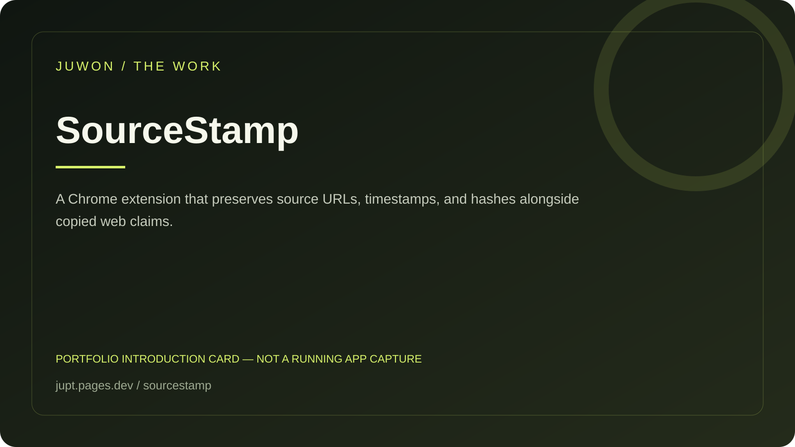

<!-- JUWON-PORTFOLIO-INTRO:START -->
# SourceStamp



*Portfolio introduction card, not a screenshot of a running application.*

*포트폴리오 소개 카드입니다. 실행 화면 캡처가 아닙니다.*

## English

A Chrome extension that preserves source URLs, timestamps, and hashes alongside copied web claims.

[View JUWON's portfolio](https://jupt.pages.dev/) · [Browse the project collection](https://jupt.pages.dev/projects)

**Scope:** This README presents the repository's documented intent and recorded visual evidence. It does not certify that every feature is complete, deployed, or currently working. Follow the original setup, safety, and license documentation below.

## 한국어

웹에서 복사한 주장에 출처·시각·해시를 함께 보존하는 확장.

[JUWON 포트폴리오 보기](https://jupt.pages.dev/) · [전체 프로젝트 보기](https://jupt.pages.dev/projects)

**확인 범위:** 저장소의 문서상 목적과 기록된 화면 근거를 소개합니다. 모든 기능의 완성·배포·현재 정상 작동을 보증하지 않습니다. 설치법·안전 주의사항·라이선스는 아래 기존 문서를 확인하세요.
<!-- JUWON-PORTFOLIO-INTRO:END -->

---

## Original documentation / 기존 문서

# SourceStamp

## Copy the claim. Keep the source.

SourceStamp turns selected web text into a portable source receipt before the context disappears.

Select a sentence, open the extension, review the page and timestamp, then copy Markdown, rich HTML, or a `.md` file. Every receipt carries a SHA-256 fingerprint so the text you shared can be checked later.

### Why this exists

The annoying part of research is rarely finding one good sentence. It is the next ten minutes:

- the quote gets pasted into a brief without its source;
- the tab gets buried under a dozen other tabs;
- a teammate asks “where did this come from?”;
- the original wording is silently edited during copy and paste.

SourceStamp is the smallest useful handoff between “I found it” and “someone else can trust it.” It is intentionally a receipt, not another research library.

## The four-second flow

1. Select text on any normal `http(s)` page.
2. Open SourceStamp from the browser toolbar.
3. Review the quote, page title, URL, capture time, and fingerprint.
4. Choose `Copy Markdown`, `Copy HTML`, or `Download .md`.

No background watcher. No account. No cloud. No model. No automatic paste or send.

### Example output

```markdown
> A source should travel with the claim.

— [Example page](<https://example.com/>)
Captured: 2026-08-29T17:00:00.000Z
Fingerprint: `sha256:...`
```

## Install locally

Requirements: Node.js 18+ and a Chromium-based browser with Manifest V3 support.

```bash
npm ci
npm run build
```

Then open `chrome://extensions`, enable **Developer mode**, choose **Load unpacked**, and select the generated `dist/` directory.

The extension asks only for `activeTab` and `scripting`. It reads the active page only when its popup is open. The source text is held in memory until you choose an export; SourceStamp does not request a host permission, use browser storage, or make a network request.

## Verify the project

```bash
npm test
npm run typecheck
npm run lint
npm run build
npm run smoke
npm audit --omit=dev --audit-level=high
```

The tests cover normalization, unsafe URL rejection, Markdown output, HTML escaping, and deterministic hashing. The smoke check validates the built MV3 package and runs a real quote through the receipt pipeline.

## What is deliberately not included

- a permanent quote database;
- hidden page crawling or background collection;
- AI summarization or a required provider;
- automatic form filling, posting, or sending;
- support for non-web schemes such as `file:` or `javascript:`.

These constraints keep the first version easy to inspect and safe to try. See [`SECURITY.md`](SECURITY.md) for the threat model and [`docs/verification.md`](docs/verification.md) for the latest run record.

## Research and next experiment

The product hypothesis and competitor scan are recorded in [`docs/research/2026-08-29-founder-note.md`](docs/research/2026-08-29-founder-note.md).

The first seven-day experiment is simple: give the extension to ten people who regularly move research from a browser into a brief, issue, or AI chat. Measure whether they create and reuse receipts at least three times without being shown a tutorial. If they do not, the next change should target the failing step, not add a library.

## Roadmap

- browser context-menu capture;
- configurable receipt templates for Markdown and HTML;
- an optional local drag-and-drop verifier for exported receipts;
- keyboard-first capture, only after the four-second flow is reliable.

## Contributing

Small, test-backed changes are welcome. Read [`CONTRIBUTING.md`](CONTRIBUTING.md) before opening an issue or pull request.

## License

MIT. See [`LICENSE`](LICENSE).
